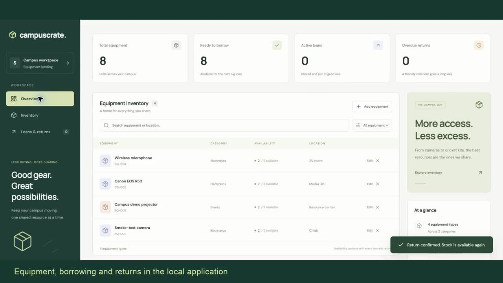

# CampusCrate demo materials

- [Narrated demonstration video](CampusCrate-Demo.mp4)
- [PowerPoint presentation](CampusCrate-Capstone.pptx)
- [PDF presentation](CampusCrate-Capstone.pdf)
- [Narration script](audio-script.md)

The narrated video runs for approximately 2 minutes 55 seconds. It demonstrates
adding equipment, borrowing, returns and the REST API, then explains testing,
container delivery, Helm, autoscaling, monitoring, Terraform and troubleshooting.
The narration is by Praneeth Budati.

The application sequence uses captured browser interactions. Presentation slides
and historical deployment evidence accompany the technical explanation. Captions
identify the recorded test, pipeline, autoscaling and monitoring evidence from
16 October 2026. The recording does not show a fresh commit-to-updated-deployment
sequence. AWS coverage is configuration validation and mock-provider tests only,
with no claim of real AWS provisioning.

The 16-slide PowerPoint includes editable text and tables, speaker notes and
source references. The PDF contains the same slides without presenter notes.

See [the full walkthrough](../docs/DEMO.md) for commands and demonstration steps.

## Video chapters

| Time | Topic |
|---|---|
| 0:00 | Introduction |
| 0:14 | Equipment creation, borrowing and return |
| 0:41 | REST API and persistence |
| 1:03 | Docker Compose |
| 1:15 | Automated tests |
| 1:31 | Recorded CI delivery |
| 1:59 | Kubernetes and Helm |
| 2:11 | Recorded autoscaling |
| 2:20 | Recorded monitoring |
| 2:28 | Troubleshooting |
| 2:33 | Terraform scope |
| 2:46 | Repository and close |
